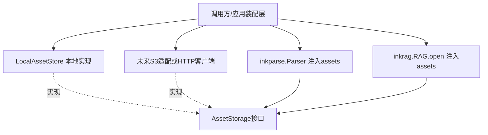

# 独立资产服务边界与依赖注入

> 本页描述当前接口。部署要求见[生产部署](deployment.md)，当前验收见[发行审查](release-readiness.md)。

2026-11-09更新。按用户纠正，存储已经从inkparse拆出为独立分发包inkstore。当前版本：inkstore 0.1.0a1、inkparse 0.4.0a1、inkrag 1.0.0a5。旧的解析内置AssetStore和RAG自动建仓库/自动复制已移除，不保留兼容门面。

## 1. 三个包各自负责什么



- **inkstore**：字节、完整性、通用不透明记录、资源引用和本地适配器。不依赖inkparse、Docling、RAG、LlamaIndex，不解释解析字段。
- **inkparse**：读取和解析文件，原生Docling结构，解析结果与元素/资源的关系。persistence.py负责将业务结果映射为通用记录及反向校验。
- **inkrag**：知识入库/检索，使用注入的资产服务校验来源；不创建、选择或复制资产仓库。
- **应用装配层**：选择实现、路径/凭证/连接和生命周期，决定共享仓库还是显式复制。业务包不关闭借入服务。

这次拆分覆盖原件、图片和解析结果记录。RAG索引/SQLite任务库等仍为现有知识后端，本轮未将所有基础设施合并进文件存储协议。当前没有HTTP进程或S3实现；独立网络服务可以通过实现同一接口的客户端注入。独立分包与网络部署是两个不同交付维度。

## 2. 替换接口

接口位于packages/inkstore/src/inkstore/contracts.py，仅包含业务必需的五个方法：

| 方法 | 约定 |
|---|---|
| put_bytes(data) → AssetInfo | 完整持久化后返回真实内容摘要；失败不返回成功身份 |
| get(asset_id) → AssetInfo | 验证存在、大小和完整性 |
| read(asset_id) → bytes | 返回与摘要一致的字节，失败不回退其他仓库 |
| save_record(record) | 全部资源就绪后原子提交不可变记录及引用；同内容重复提交幂等 |
| load_record(record_id) | 返回完整记录并验证引用，损坏/缺失明确失败 |

管理功能不强加给所有业务客户端。本地实现另提供put_file、list_assets、list_records和delete_unreferenced。其他后端只要遵守五个方法的语义，就能直接注入，无需继承具体类或注册插件。

StoredRecord包含record_id、source_asset_id、payload（不透明JSON字符串）与references。ResourceReference只表达asset_id、locator、role、page；locator/role由业务解释。存储包不导入ParseResult。解析层负责严格校验Docling元素、原件摘要、大小与记录关系。

本地适配器按SHA256保存不可变字节，支持仓库内去重、读取校验、短SQL事务、引用删除保护和跨进程写锁。文件名不决定字节身份；同名新内容得到新ID。每个资源最多20MiB，记录最多32MiB。

## 3. 如何注入

```python
from inkstore.local import LocalAssetStore
from inkparse import Parser, ParseRequest, FileSource, save_result
from inkrag import RAG

# 只有应用层选择本地实现及目录。
storage = LocalAssetStore.open("./asset-data")
result = Parser().parse(
    ParseRequest(source=FileSource(path="manual.pdf")), assets=storage
)
save_result(result, "parsed.json")

with RAG.open("./knowledge", embedding=embedding, assets=storage) as rag:
    rag.ingest_parsed("parsed.json")
    origin = rag.retrieve("E102怎么处理？").hits[0].metadata["parse_origin"]
    original_bytes = storage.read(origin["source_asset_id"])
    images = [storage.read(asset_id) for asset_id in origin["related_asset_ids"]]
```

将storage替换成遵守AssetStorage的远程客户端后，解析与RAG业务调用不用改。没有注入时，Parser和RAG仍能处理纯文本；引用资产的JSON入库明确报storage_required，绝不自动创建知识目录下的assets仓库。rag.assets仅返回借入实例，未配置时也明确拒绝。

注入配置不写入交换JSON。路径、连接、鉴权与重试策略由宿主管理；asset_id不是访问凭证。未来HTTP服务需要服务端授权校验，不能因为知道摘要就允许下载。

## 4. 解析结果与资产如何关联

结果协议继续使用inkparse.result.v3，结构和内容身份未因拆包改变：

```text
source.asset_id             原件字节SHA256
assets[].asset_id           提取图片等资源SHA256
assets[].element_ref        本结果中的Docling元素，例如#/pictures/0
assets[].role / page        资源用途及原件物理页
result_id                   整个解析结果的规范化内容摘要
```

一个原件可以产生多个解析结果，一个结果关联多个原生元素/资源，同一资源可被重复引用。元素引用只在所指结果内有效，不是跨重解析的永久段落ID。

解析前保存原件，解析时保存可导出的PDF嵌入位图，最后由save_stored_result(result, storage)验证业务语义并提交通用记录。load_stored_result(storage, id)负责还原并核对结果与资源关系。存储不直接提供save_result(ParseResult)，因此以后换解析模型不需要修改资产服务。

## 5. 共享与复制由调用方决定

共享同一个服务实例时无需复制。需要独立仓库时显式执行：

```python
from inkparse import copy_result
copy_result(result, source_storage, target_storage)
with RAG.open("./knowledge", embedding=embedding, assets=target_storage) as rag:
    rag.ingest_parsed("parsed.json")
```

copy_result是解析层的显式迁移适配：按已验证引用读取字节，验证目标返回摘要，再提交记录。RAG不会自行执行复制，也不会猜测源仓库位置。JSON只带引用，不携带原件/图片字节。没有注入存储的纯内存结果source.asset_id为空，不能保证之后能预览原件。

## 6. 生命周期与事实边界

本地实现使用inkstore.json作为新仓库标记；旧inkparse内置仓库不自动打开、覆盖或迁移。原目录和字节保留，当前需重新解析到新服务或另行实施显式迁移。本轮没有迁移用户旧资料。

记录提交前验证所有资产，写入失败可能留下未引用对象供重试或清理。已提交记录不可改写，引用中的资产拒绝删除；暂不提供记录删除、自动TTL或垃圾回收，保留策略仍待设计。解析业务记录有效、但后续RAG嵌入失败时，旧知识快照不切换。

原子文件写入与SQLite事务不构成跨系统事务，也不承诺共享盘/断电/多机容灾。RAG原有任务输入副本仍保留，不能将仓库去重解释为全目录仅有一份物理字节。

图片仅保存PDF中可导出的嵌入位图及页级关联，不代表OCR、图意理解、精确图框或矢量图恢复。预览裁剪可由宿主生成后保存，但模块不生成这些资源。Markdown导出仍是图片占位，没有自动附件包或URL。

## 7. 验证

[替换测试](../tests/test_storage_injection.py) · [完整资产回归](../tests/test_assets.py)

相同业务流程在本地实现和测试专用内存实现下运行，未注入不建仓库、后端故障不回退且旧快照保留。内存实现仅用于替换验证，不作为生产备用后端。独立分发安装验证另记录于[验证入口](release-readiness.md)。没有实现远程HTTP服务或运行云端兼容性实测。
