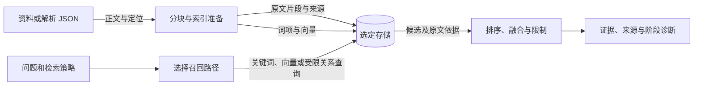

# InkRAG Core 使用指南

把售后手册、政策和 PDF 的内容检索出来，并让调用方回查原文。一个典型查询是「AB-123 温度传感器报警怎么处理」。业务系统需要看到对应型号的操作步骤、资料版本与可用的页码或元素定位。

## 选择入口

| 使用场景 | 入口 |
| --- | --- |
| 在 Python 中组装和运行检索 | `inkrag-core`，导入名 `inkrag_core`。按应用需要选择解析、分块、模型、分词和存储。 |
| 单独解析文档、保留结构或使用 OCR | [`inkparse`](parsing-core.md)。Docling 的 PDF 和图片解析按说明准备模型工件。 |
| 延用既有 Python 集成 | [`inkrag.RAG` SDK](python-sdk.md)。原有知识目录继续通过原入口读取。 |
| 多人审校并将知识发布给业务应用 | [工作台](../README.md#工作台)及 [HTTP API](platform-http.md)，沿用工作台自己的权限、任务与发布链路。 |

[离线交互手册](learn/index.html)沿着一个手册用例讲解各阶段，并展示如何读代码、改一处策略和验证失败恢复。

## 快速开始

在仓库根目录使用 Python 3.12 和 uv 运行。

```sh
uv run --locked --no-dev --package inkrag-core python examples/core_retrieval.py
```

示例使用合成设备手册和确定性向量。精确查 E102 返回第 4 页。图和多步检索还能找回第 82 页的安全步骤。用生产语料评价语义召回时，换成真实嵌入模型。

基础包用 Python 3.12 标准库即可运行。需要直接解析文件时安装 `inkrag-core[parse]`，需要 Docling 时用 `inkrag-core[docling]`。可选的 `[jieba]` 提供词典分词，`[postgres]` 提供 PostgreSQL 驱动。需要在源码目录运行某项扩展时，给上述 `uv run` 命令加对应的 `--extra`，例如 `--extra parse`。独立安装从包含 Core 的 GitHub 发行附件选取 wheel，配套依赖也使用对应发行包。

## 接入自己的资料

组件由应用注入。先确定给索引绑定的模型身份、维度和分词器身份，再打开集合。`Engine` 负责调用组件和返回证据。兼容 OpenAI 嵌入协议的提供商可以使用 `OpenAICompatibleEmbedding`，也可自行实现 `Embedding` 的 `fingerprint`、`dimensions` 和按输入顺序返回向量的 `embed(texts)`。

```python
import os

from inkrag_core import (
    BigramAnalyzer, CharacterChunker, Engine, IndexProfile, ParsedDocument, Part,
)
from inkrag_core.embedding import OpenAICompatibleEmbedding
from inkrag_core.sqlite import SQLiteIndex

embedding = OpenAICompatibleEmbedding(
    base_url=os.environ["EMBEDDING_BASE_URL"],
    model=os.environ["EMBEDDING_MODEL"],
    dimensions=int(os.environ["EMBEDDING_DIMENSIONS"]),
    api_key=os.environ.get("EMBEDDING_API_KEY"),
    revision=os.environ.get("EMBEDDING_REVISION", "default"),
)
analyzer = BigramAnalyzer()
profile = IndexProfile(embedding.fingerprint, embedding.dimensions, analyzer.fingerprint)
index = SQLiteIndex("manuals.sqlite3", "support-v1", profile)
engine = Engine(index, embedding, analyzer, chunker=CharacterChunker(600, 80))

# 这里用确定的原文片段展示入库契约。page 和 element_ref 取自实际解析时的定位。
document = ParsedDocument(
    "AB-123.pdf",
    parts=(Part("AB-123 温度传感器报警时，先断开电源。", "#/texts/0", page=2),),
)
engine.ingest("sensor-manual-ab-123", document)
result = engine.retrieve("AB-123", routes=("keyword",), top_k=5)
for hit in result.hits:
    print(hit.chunk.text, hit.chunk.source)
```

上面使用的环境变量由示例读取。填写提供商实际的 API 根地址、模型、向量维度与凭证。入库会把片段正文发送给嵌入模型，向量查询会发送问题。处理受限资料时选择符合该数据范围的服务或在本机注入模型。关键词查询可以借已写入的词项查找证据。

`base_url` 可填以 `/v1` 结尾的 API 根地址，适配器自动追加 `/embeddings`。远程地址须使用 HTTPS，回环服务可用 HTTP。`dimensions` 是对服务实际输出的校验值。需要改变模型输出维度时，由服务或自有适配器配置。若服务升级了同名模型，用新的 `revision` 标明版本并重建集合。

### 从文件或解析 JSON 入库

- **携带原文和定位的 Core JSON** 使用 `ParsedDocument.from_json(data)` 校验后再传给 `engine.ingest(document_id, parsed)`。输出用 `to_json()`。每个 `Part` 包含原文和元素位置，可以包含页码。 [JSON Schema](schemas/inkrag-document.v1.schema.json)
- **已有 InkParse 交换包** 使用 `InkparseAdapter().load(path)` 转换成相同的 `ParsedDocument`。完整表格、附件和审校记录留在原交换包。Core 保存检索所需的原文和引用。
- **直接读文件** 给 `engine.ingest_file(document_id, path, parser=InkparseAdapter())` 传入解析器。复杂 PDF 或图片可设 `InkparseAdapter(engine="docling", ocr=True)`，工件和格式条件见 [解析手册](parsing-core.md)。

`InkparseAdapter` 的导入路径是 `inkrag_core.inkparse_adapter`。注入自有解析器时实现 `parse(path) -> ParsedDocument`，并为每段原文提供可回查的定位。

### 在 SQLite 和 PostgreSQL 之间选择

本地试跑使用 `SQLiteIndex(path, collection, profile)`。适配器创建自己的表，片段、词项和向量存在同一个数据库。SQLite 查询在范围内计算 BM25 和精确余弦。共享应用可用 `PostgresIndex(dsn, collection, profile)`，在 PostgreSQL 中计算 BM25，用 pgvector 做范围内的精确余弦排序。两个适配器都接收 Python 预切的词项，分词发生在同一套注入规则中。

启用 PostgreSQL 适配器时安装 `inkrag-core[postgres]`。服务器安装 pgvector 以后，由部署账号启用扩展。

```sql
CREATE EXTENSION IF NOT EXISTS vector WITH SCHEMA public;
```

启动前通过 `PostgresIndex(provisioner_dsn, "support-v1", profile, initialize=True)` 创建 Core 表和集合。使用 `inkrag_core.postgres` 导入。应用运行时用 `PostgresIndex(runtime_dsn, "support-v1", profile)` 打开已有集合。由管理员将下列权限授给专用的运行角色。

```sql
GRANT USAGE ON SCHEMA inkrag_core TO app_runtime;
GRANT SELECT ON inkrag_core.collections TO app_runtime;
GRANT SELECT, INSERT, DELETE ON inkrag_core.chunks, inkrag_core.postings TO app_runtime;
```

给 `document_ids` 传入已经过鉴权的资料 ID 集合。`None` 意味着使用整个集合，空集合会直接返回空证据。服务端应根据可信身份自行计算范围，再与用户请求的筛选求交集。数据库凭证、业务鉴权、TLS、连接管理和备份由部署方配置。SQLite 文件放在本机可持久访问的存储上，备份时用 SQLite 一致性备份方式。PostgreSQL 可用服务商的数据库备份设施，恢复后重开集合并核对原文来源。

PostgreSQL 同次查询使用可重复读事务。单条 SQL 上限 30 秒，开放的空闲读事务上限 120 秒。配置外部模型和自定义多跳策略时应另设应用请求时限。单份资料的向量入库上限为 200 万个标量，超出预算可按保留原件页码的章节分批入库。

精确余弦可作为近似索引的对照基线。随着有效过滤范围内的片段增加，向量查询要比较更多候选。用自己业务的筛选比例和查询分布实测尾延迟。当它超过应用预算时，再评估近似索引或其他检索后端，并对照精确基线的漏召回。

## 入库和查询



入库开始前先确定资料身份。更新同一份手册时沿用同一身份，业务上不同的两份文件使用不同身份。解析、分块、索引三个环节要保留可对应的原文定位。对只保留原文的格式，结果可以用元素引用定位。对有物理页的 PDF，可以核对页码和页面上下文。保管原件和解析结果，便于审校和重新构建派生索引。

关键词查询对术语和完整编号有效。向量查询从语义相近的正文召回证据，要求查询和入库使用同一模型身份与维度。混合查询把两路结果按排名融合。图查询沿显式登记的关系查找证据。分步查询把复合问题拆成多个检索步骤，或依据中间证据决定下一步；每一步都要受来源范围和资源预算约束。

## 选择检索策略

| 需求 | 调用方式 | 结果如何解释 |
| --- | --- | --- |
| 查询完整编号或关键术语 | `routes=("keyword",)` | 默认双字分词与可选 Jieba 都保留英数连字符型号。用单路词项查询测试相近编号；不需要调用查询嵌入模型。 |
| 查询同义描述 | `routes=("vector",)` | 在限定范围内按余弦排序。向量相近只表明模型判断文本相关，使用前核对来源。 |
| 同时利用关键词和语义 | `routes=("keyword", "vector")` | 默认路线。RRF 合并两路候选。带型号的自然语言问题仍可能召回别的型号，用资料范围约束精确业务条件。 |
| 寻找已登记的跨资料关系 | `routes=("graph",)`、`graph=...` 和 `graph_seeds=("E102",)` | 每条边要有当前范围内可读的原文片段。可与关键词、向量合并；有候选时也可从其片段得到关系起点。 |
| 查包含多个子问题的复合问题 | `strategy=decomposition(planner)` 或 `strategy=iterative(next_query)` | 策略决定子问题，每一跳沿用本次选择的路线与资料范围。结果保留实际执行的子问题，需检查遗漏和截断。 |

`top_k` 控制最终证据条数，取值 1–100，默认 5。当前每路候选深度是 `min(top_k * 3, 100)`，RRF 使用常数 60。不同路线的分数含义各异。排序诊断要同时查看最终 `hits` 和 `steps` 中的逐路片段排名。日志应限制原始问题和片段的留存范围。

### 图和分步配置

从 `inkrag_core.graph` 导入 `GraphEdge`、`GraphLimits` 和 `ReferenceGraph`。每条边明确提供起点、关系、终点和支持它的 `chunk_id`，片段 ID 取自 `engine.ingest()` 的返回值。只走图时给一个或多个起点。图通道与其他通道合用且未指定起点时，引擎从前序融合候选的片段查找登记过的起点。要核对一条指定的完整路径，显式给出起点。修改原文导致旧片段失效后，重新检查并登记涉及它的边。图关系由应用保存和配置。

```python
from inkrag_core.graph import GraphEdge, GraphLimits, ReferenceGraph

# fault_chunk 和 safety_chunk 取自已入库的两份证据。
graph = ReferenceGraph([
    GraphEdge("E102", "引用", "安全要求 8.2", fault_chunk.id),
    GraphEdge("安全要求 8.2", "要求", "核对接线", safety_chunk.id),
])
result = engine.retrieve(
    "E102 怎么处理？",
    routes=("graph",),
    graph=graph,
    graph_seeds=("E102",),
    graph_limits=GraphLimits(max_depth=2),
    document_ids=frozenset({fault_chunk.document_id, safety_chunk.document_id}),
)
for path in result.paths:
    for edge, proof in zip(path.edges, path.evidence, strict=True):
        print(edge.relation, edge.target, proof.source)
```

从 `inkrag_core.multihop` 导入 `MultiHopLimits`、`decomposition` 和 `iterative`。预先知道子问题时，`decomposition` 接受一个把原问题转成问题序列的回调。需要读取证据后决定下一问时，`iterative` 先查原问，再调用 `next_query(question, hops)`。返回 `None` 表示结束。内置预算限制步数和证据条数；发生预算截断时检查结果的 `truncated`，必要时缩小范围或调整预算。接入外部规划模型时，调用方负责模型时限、费用和文本出网。

```python
from inkrag_core.multihop import Hop, MultiHopLimits, iterative

def next_query(question: str, hops: tuple[Hop, ...]) -> str | None:
    """只在首跳原文明确出现安全章节引用时继续。"""
    if len(hops) == 1 and any("安全要求 8.2" in hit.chunk.text for hit in hops[0].hits):
        return "安全要求 8.2"
    return None

result = engine.retrieve(
    "E102",
    routes=("keyword",),
    strategy=iterative(next_query),
    hop_limits=MultiHopLimits(max_queries=2, max_evidence=6),
    document_ids=frozenset({fault_chunk.document_id, safety_chunk.document_id}),
)
print([step.query for step in result.steps])
```

| 配置 | 默认值 | 影响 |
| --- | --- | --- |
| `CharacterChunker(size, overlap)` | 600、80 | 片段字符数和相邻块重叠。按实际模型 token 预算选择长度或自有切分器。 |
| `Engine(..., batch_size=...)` | 32 | 入库时每次嵌入调用的片段数。按模型批量上限调整。 |
| `GraphLimits` | 深度 2、节点 32、单点扩展 8、边检查 256 | 每一次图遍历的预算。指定与调用方问题相称的范围。 |
| `MultiHopLimits` | 查询 4 次、证据 12 条、单个问题 4,000 字符 | 每次分步查询的预算。策略接收实际找到并且仍在预算内的原文。 |

以相同语料上的混合检索作为对照，再验证图和分步找回了哪些独有的必要证据。这里的图使用已登记的局部关系。跨库主题摘要还需要另行设计实体抽取、聚类、摘要和原文引用验证。

## 配置取舍

| 责任 | 要决定什么 | 变更前检查 |
| --- | --- | --- |
| 解析与块大小 | 选能保留所需结构的解析器，从章节或表格上下文出发，再设长度和重叠 | 用一条跨段证据、一张表、一份有页码的文档检查切分后的出处 |
| 分词与编号 | 中文材料比较领域词切分，完整保留型号值 | 用近似型号、未知型号和全角大小写变化验证。混合问句的词项增益和硬过滤分别验收 |
| 嵌入 | 指定稳定模型身份、维度和调用环境 | 更换模型或维度时，准备新索引并重算向量；先对照真实同义问法和原文引用 |
| 存储 | 单机先用 SQLite；需要共享数据库和集中运维时评估 PostgreSQL + pgvector | 用同一小批资料比较本地与远程查询、重开、事务回滚及带筛选的候选；按目标环境测容量 |
| 策略 | 优先选择能找齐证据的简单路线，按实际漏召回加通道或步骤 | 保存逐题证据和阶段耗时，避免新通道挤掉已命中的关键证据 |

BM25 根据词频、稀有程度和片段长度对词项匹配排序。它的前提是已选择合适的分词。RRF 按各通道排名加权，适合合并不同量纲的关键词和向量分数。给定常数 `k`，一路第 `r` 名贡献 `1 / (k + r)`。融合只能重排已召回的候选，所以要先查对的原文有没有进入任一路候选。

`BigramAnalyzer()` 给连续中文保留单字和相邻双字，并保留英数连字符型号。安装 `inkrag-core[jieba]` 后可以使用 `JiebaAnalyzer()`。为自有分析器实现 `LexicalAnalyzer`，版本标识涵盖词典和词项规则。以新的集合身份重建索引，然后使用相同问集比较证据覆盖、误匹配和耗时。

## 用四类问题验收

| 问题 | 建议从哪里开始 | 应看到什么 | 必做反例 |
| --- | --- | --- | --- |
| 「AB-123」 | 关键词与精确编号 | 只返回含完整编号的适用手册 | 加入 AB-1234，未知编号返回空 |
| 「这个东西退回去的运费谁负责」 | 混合检索 | 语义路召回写着「退货运费」的条款，关键词路保留相关术语 | 同时放入不适用地区或版本的相似政策，检查筛选和来源 |
| 「断电后检查什么接头」 | 有物理页的文本 PDF | 命中文本和原文出处可逐项核对 | 放入旧版步骤和相邻页干扰段，核对版本和页码 |
| 「北区型号的延保找哪个团队」 | 先跑混合基线，再查关系或分步 | 区域、适用政策和受理团队都有各自原文证据 | 撤掉中间关系或排除该资料，路径应中断；检查深度、去重和停止原因 |

选择测试集后固定原件、模型、筛选和 Top K。每题记下必须出现的证据组与禁止出现的证据。先检查前 K 条是否包含全部要求的证据，再对照首条正确证据的位置、分阶段耗时和错误类型。需要判断回答质量时，另外核对每项陈述与原文是否一致。

### 真实中文向量小样

本地 CPU 使用固定版本 BGE，解析 8 份有文字层的合成中文 PDF，得 17 个片段。4 道有答案问题中，关键词、向量和混合的首条证据命中均为 1/4，前 3 条分别为 3/4、4/4、4/4。向量把近似故障码 E1020 排在 E102 之前，关键词和混合则将 E102 排在第一。无答案题仍能召回候选。这个结果说明编号查询、候选召回和答案判断各有验收条件。 [逐题证据](evidence/core-real-model.json) · [模型及版本](https://huggingface.co/BAAI/bge-small-zh-v1.5/tree/7999e1d3359715c523056ef9478215996d62a620)

### 复跑数据库行为

在环回地址的独立 PostgreSQL 测试库（库名以前缀 `inkrag_core_test` 开头）准备 pgvector，把有初始化与创建测试角色权限的连接串注入 `INKRAG_CORE_TEST_POSTGRES_DSN`。测试创建临时集合和受限运行角色，入库与查询使用该运行角色。

```sh
uv run --locked --all-packages --all-extras pytest tests/test_core_indexes.py
```

检查两种数据库的完整词项、预过滤与排名、同次读取一致性、错误配置拒绝及替换中断回滚。服务测试通过说明对应数据库和负例可以复现。语义召回、目标并发、持续运行及恢复时限各需自己的验证。

## 更改和恢复

- 策略参数更新先用固定问题集对照候选和最终排序。分词规则、切分或模型身份变化时，重建受影响的派生索引。
- 空结果说明在当前策略和范围内没有可返回证据。依赖失败会向调用方抛出错误。排查时先区分缺少原文、未生成片段、某路未召回、排序截断以及作用域限制。
- 将工作目录、资料、解析包和关系清单放在可恢复的位置。用独立测试库验证中断后能重开，失败更新不会呈现半份资料，成功替换后旧片段退出查询。并发更新同一资料时，应用负责新旧事件顺序；数据库保证整份替换事务的一致性。
- 从既有 `inkrag.RAG` 或工作台迁移时，以原件或支持的解析 JSON 在新库重新入库，再比较引用、召回、更新与删除的行为。保留旧目录和服务，待新链路验证后切换调用方。
- 正式环境另测生产数据分布、权限、并发、恢复与模型依赖。对 PostgreSQL 演练资产和数据库的协调恢复，回读实际命中与引用。
