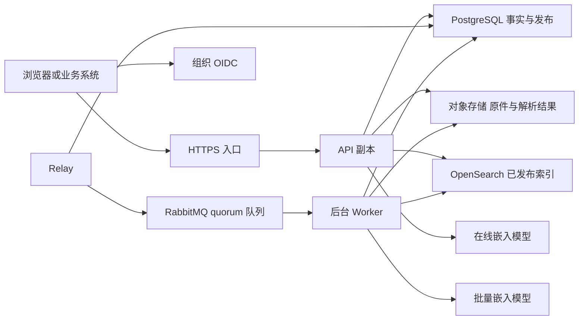

# 生产部署方案

适用于将 InkRAG 作为企业文档检索服务自托管的团队。先明确一个要验收的知识库、资料规模、租户和业务调用方，再据此选择资源。开发 Compose 用于本机演练。

## 角色、状态和连接

| 进程或服务 | 部署原则 |
| --- | --- |
| HTTPS 入口和 API | API 可多副本。网关配置有界请求体、请求速率和转发超时。管理流量、检索和上传可按调用方分配配额。OIDC 使用生产客户端、准确的回调地址和最小组织角色。 |
| 迁移任务 | 单独凭据和一次性任务。运行时角色必须为非 owner、无管理权限。数据库仅对必要进程开放 TLS。 |
| Worker 与 Relay | Worker 使用任务预算，放在支持严格 Linux 解析隔离的节点。Relay 读取 PostgreSQL 的可靠投递记录和租约，两者均使用受限凭据。Rabbit 节点跨故障域，使用 quorum 队列。 |
| OpenSearch | API 读取发布索引，构建进程负责写入候选和冻结。各环境分开凭据和索引权限，配置跨故障域副本。 |
| S3 | 存储不可变原件和结果，启用版本管理和备份策略。限制前缀访问，保留期和物理擦除由部署方按业务要求实施。 |
| 模型端点 | 批量与在线资源池独立。固定权重、分词器和 revision，换模型时建立新候选并评测。 |

迁移命令仅读取运行档和迁移连接。Relay 当前复用应用配置校验，combined 模式仍要求相应依赖 URL；它实际使用 PostgreSQL 与 Rabbit。只向进程提供需要的搜索、模型或对象存储凭据。

为各进程注入 [运行手册](production-runbook.md#连接与预算变量) 的环境变量。启动顺序为外部依赖就绪、运行迁移、部署 API/Worker/Relay、验证健康及业务流程、切入流量。镜像使用审核过的 digest。供应链、模型许可和漏洞结果随发行保留。[OpenSearch 角色参考](https://docs.opensearch.org/latest/security-plugin/access-control/users-roles/)

## 上线前的验收

| 检查 | 要看到的结果 |
| --- | --- |
| 确认身份与范围 | 管理员可发布，业务凭证仅能访问目标库。用同一个资料名和相同搜索词测试两个租户。撤销凭证、删除资料后重放请求。 |
| 确认旧发布安全 | 进行一次有意失败的候选构建和一次成功发布，检查前者不会切换线上，后者指向预期索引。执行回滚并复核撤销资料不会出现。 |
| 确认故障可恢复 | 分别中止 Worker、暂时隔离 Rabbit、断开搜索节点。在故障和恢复后记录任务状态、最终发布、客户端可见错误及耗时。 |
| 确认容量与质量 | 使用脱敏的实际资料和人工标注问题。记录含上传、后台积压和高选择性过滤的持续混合负载，报告查询成功率、p95/p99、最老待办、资源峰值和引用命中。 |
| 确认可运维 | 开启就绪、任务失败、最老待办、搜索分片、对象完整性和备份新鲜度告警。用 request/job/build/release ID 串联证据，不把正文或密钥写入日志。 |

## 恢复与升级

1. 为 PostgreSQL 配置基础备份和 WAL 归档，为原件与解析对象保留可恢复版本。记录同一个恢复点的发布 ID、索引名、模型 revision 和资产检查范围。搜索快照用来保留既有发布索引的物理身份。 [PostgreSQL 时间点恢复](https://www.postgresql.org/docs/17/continuous-archiving.html) · [OpenSearch 快照](https://docs.opensearch.org/latest/opensearch/snapshot-restore/)
2. 在独立环境先暂停写入、Worker 和 Relay，再恢复数据库、对象和搜索快照。验证租户范围、原件/结果摘要、当前授权和发布映射。通过实际查询与引用回查后再开放流量。
3. 若没有搜索快照，使用冻结的解析资产构建新索引。对于依赖历史发布身份的应用，应先恢复其对应物理索引。以当前工作态构建并发布新版本，会创建新发布身份，需业务方确认范围和内容。
4. 升级前用目标数据规模在副本演练迁移，记录耗时和锁等待。预先定义兼容窗口，回滚应用镜像前确认数据库仍支持该版本；有破坏性变更时使用演练过的恢复路径。
5. 记录从事件开始到恢复可查询的时间、恢复点与故障时间的差值、未恢复的对象及例外。用这些实测值确认 RTO/RPO。

[当前验证和缺口](release-readiness.md) 说明哪些是隔离环境证据。每个生产环境仍需完成自身的故障域、身份、容量与恢复验收。
