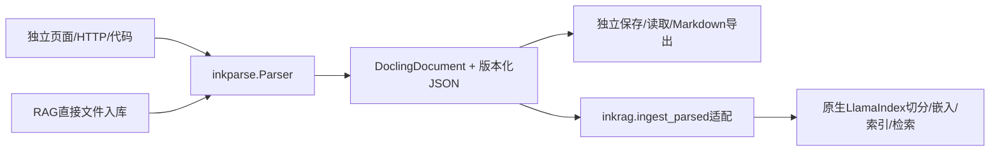

# 独立解析核心与JSON交换协议

> 本页描述当前接口。部署要求见[生产部署](deployment.md)，当前验收见[发行审查](release-readiness.md)。

`inkparse` 独立解析文件。平台通过同一个入口在隔离子进程运行解析；本地 SDK 可以直接调用。默认使用内置解析器，按需安装并选择 Docling。

## 输入格式

原件是文件，控制参数为严格JSON。代码可使用同一个Pydantic模型构造，不维护第二套页面配置。

```json
{
  "schema_version": "inkparse.request.v1",
  "source": {"kind": "file", "path": "./manual.md"},
  "options": {"format": "auto", "max_bytes": 20971520}
}
```

- `source.kind`首版仅file；path只在调用方本机有意义，HTTP接入后需显式映射受控上传引用，不能把任意服务器路径暴露给网页。
- format为auto/text/markdown/pdf；auto按扩展名，显式格式可处理无扩展名文件。无静默回退。
- max_bytes为1到20MiB，采用有上限的一次读取；之后解析冻结字节，原件后续变化不改变本次结果。
- 未知协议、未知字段、错误类型明确拒绝；OCR、视觉、Office、URL等选项尚未支持，不能传入后忽略。
- [完整请求Schema](schemas/parse-request.v1.schema.json)由实际模型生成。schema_version可省略采用当前默认；跨系统请求建议显式传入。

```python
request = ParseRequest.model_validate_json(request_json)
result = Parser().parse(request)
```

## 输出格式

```text
schema_version: inkparse.result.v3
result_id: SHA256(规范化的其余结果字段)
revision: 1或后续修订整数
previous_result_id: 前序结果ID，首版为空
source: {name, format, sha256, size_bytes, asset_id?}
options: 本次实际请求选项
engine: {name, version, docling_core_version}
coverage: text_only
document: 原生DoclingDocument JSON（自身也带版本）
warnings: [{code, message, page}]
assets: [{asset_id, element_ref, role, page, media_type}]
```

[完整输出Schema](schemas/parse-result.v3.schema.json) · [可读取的真实样例](schemas/parse-result.v3.example.json)。外层保存业务交换事实，正文复用Docling模型；不把Markdown设为唯一事实，也不把原型的演示Block结构带进正式核心。[Docling原生结构依据](https://docling-project.github.io/docling/concepts/docling_document/)

TXT/MD当前是一份原生文本元素，MD语法原样保留。PDF每个非空文本页对应文本元素，物理页保留，空白页不重新编号；区域仅为整页范围，并附警告，不声称逐字定位。表格/图/复杂顺序尚未重建，coverage始终text_only；有图片的文本页列出遗漏警告，只有图像而无文字的页要求OCR并拒绝整次解析。

`source.sha256`对应本次读入原始字节，`result_id`绑定来源、配置、文档与风险提示。摘要检测意外损坏，不证明发送方可信或原文真实。源码路径不输出；包中URI不会被加载器当作文件路径或URL自动读取。JSON不包含资源字节；显式注入AssetStorage时原件和位图保存在仓库，JSON保存稳定引用，见[资产存储与关联](asset-storage.md)。

Parser生成revision=1，revise_result(result, changes)通过原生文本引用创建后续修订及previous_result_id；资产仓库保存不可变结果。当前仅支持文字替换，不支持结构增删或移动。原生Docling内部可变，所以保存/消费重新序列化校验；直接修改内容会使摘要失效，不能沿用原result_id冒充旧解析。revise_result已生成新版本、前序ID与对应摘要，不能直接套用原型保存逻辑。

## 模块关系



| 位置 | 职责 |
|---|---|
| packages/inkparse/src/inkparse/models.py | 请求/交换包、严格校验、内容摘要；正文使用原生类型 |
| 同目录parser.py | 读取冻结字节，调用成熟pypdf，装配原生文档；不创建数据库或选择模型 |
| 同目录io.py | JSON读取、原子保存、Markdown导出；文件位置由调用者决定 |
| 同目录persistence.py | 解析结果与通用记录之间映射、校验、显式复制 |
| packages/inkstore/src/inkstore/contracts.py、local.py | 通用资产接口与独立本地实现，不解释解析模型 |
| src/inkrag/documents.py | 解析结果转原生LlamaIndex Document，补可信RAG作用域，复用原有切分 |
| src/inkrag/ingestion.py、rag.py | 同一入库提交规则，保留失败任务与旧快照；新增明确的JSON入库入口 |

当前实现的依赖单向：InkRAG依赖inkparse，两个业务包依赖inkstore的资产接口；inkstore不依赖业务包，inkparse不依赖RAG或LlamaIndex。三个wheel分别构建；原生文档契约由解析包持有，通用资产服务提供独立接口及本地实现。独立解析安装inkparse及其inkstore依赖，融合产品再安装inkrag；应用层装配存储实现。Docling-core自身有数据处理依赖，这里没有引入完整Docling模型引擎或模型下载。

## 双包串联

```python
from inkparse import Parser, ParseRequest, FileSource, save_result
from inkrag import RAG

result = Parser().parse(ParseRequest(source=FileSource(path="manual.md")))
save_result(result, "parsed.json")  # 到这里已经独立完成解析

# embedding由调用者持有；知识目录使用全新位置。
with RAG.open("./knowledge", embedding=embedding) as rag:
    receipt = rag.ingest_parsed("parsed.json", document_id="manual")
    hits = rag.retrieve("A100保修多久？").hits
```

RAG先冻结JSON输入载体，再验证协议与摘要。`source.name/uri`表示RAG保存的输入载体（例如parsed.json）；`parse_origin`另存结果ID/修订、原件名/SHA和原生元素引用，page保留物理页。两者不混称“已经保存原始PDF”。带资产引用的结果必须注入能访问全部引用资源的资产服务，应用层显式共享/复制资源后，可通过该服务回查；无资产引用的结果仍不能凭名称/摘要还原原件。

RAG的租户/知识库/资料版本来自本地可信上下文，不接受交换包覆盖。来源元数据不参与模型输入。桥接当前只为文本建立向量，对已绑定位图保留来源附件；遇其他未适配内容明确报错；坏包与后续嵌入/提交失败沿用原失败保旧规则。直接`rag.ingest(file)`也复用同一个Parser，原公开调用形式保留。

## 可观察验收与边界

- 独立解析没有LlamaIndex、RAG或模型时可运行，PDF物理页和JSON保存重读一致。
- JSON→RAG在原件删除后仍可完成；来源身份可查，知识目录关闭重开后快照不变。
- 未知协议、空白、错误编码、不支持格式、预算超限和摘要篡改明确失败；扫描页沿原回归验证拒绝。
- 保存替换失败保留旧结果并清理本次临时文件；坏包入库留下失败任务、不替换旧知识。
- 严格类型、中文说明、格式/规则检查与原常规回归全部运行；新结果见[验收记录](release-readiness.md)。原M1真实模型记录保留历史，本轮未据此宣称新实现真实模型质量已验收。

原子替换保证正常文件系统操作不暴露半份JSON，不承诺硬件断电恢复；没有自动建输出父目录、任务恢复、多人编辑或完整保留策略。结构增删/图片语义/Office、真实业务标注继续按后续切片推进；文字修订和真实页面/HTTP已接入，见service-operations.md，不把本次核心视为完整解析产品完成。


## 存储边界更新

按用户最新要求，资产实现独立到inkstore；Parser.parse(..., assets=storage)与RAG.open(..., assets=storage)只依赖AssetStorage接口。未注入时不自动创建仓库，RAG不再自动复制，跨仓库由应用层显式调用copy_result。解析结果语义在inkparse.persistence中处理，存储只保存通用记录。当前完整装配和边界见[独立资产服务](asset-storage.md)，较早的RAG自建目录描述不再适用。

## 2026-11-11 成熟组件复用原则

用户确认：成熟组件能带来实际收益时优先复用；如果增加项目复杂度和维护负担，则不用。此决定替换此前对解析包依赖LlamaIndex的一概禁止，不改变解析可独立安装运行、不依赖RAG业务包、不强制模型或RAG服务的要求。

具体组件按能力保留、自有代码减少量、依赖与适配成本、安装运行负担及长期维护成本综合判断。LlamaIndex Reader、Docling等均可作为候选，不因框架名称直接采纳或排除。上文无LlamaIndex依赖描述的是当前实现事实，不再是永久选型约束。

本次只更新选型原则；未新增依赖、替换读取器或完成候选对比实测，不把原则确认记为解析能力升级。

## 2026-11-11 内置与Docling并行适配

用户在实现期间明确调整方向：保留当前内置基础功能，Docling作为另一可选解析工具；未来每种工具单独目录管理，统一输出协议。此决定替代“以Docling替换旧读取器”的迁移设想。正式入口仍为Parser，options.engine默认为builtin；非默认选择写入结果内容摘要。适配目录为packages/inkparse/src/inkparse/adapters/builtin和docling。

统一产物仍是ParseResult中的DoclingDocument及资产/来源/警告，审校和交付不依赖调用了哪个读取器。Docling PDF/图片使用预置CPU模型，HTML/MD禁止远程/本地抓图；TXT和任意JSON/XML明确借用内置薄输入适配。表格、坐标或警告差异显式表达，不自动回退。当前新增XLSX和常用位图输入，其他官方格式不凭安装引擎即宣称支持。

HTTP上传在原二进制请求的query增加parser_engine=builtin|docling。服务能力返回parse_engines数组，其中id/name/formats/available/reason/pending_formats解释工具及未准备的格式。上传工具和幂等身份冻结到PG任务payload，worker隔离调用同一Parser；重试及重新解析沿用工具。builtin幂等摘要保持升级前算法，旧payload缺字段按builtin解释。

新引擎的离线模型准备、配置与运行条件见[解析包入口](../packages/inkparse/README.md)。旧解析质量证据仅证明内置路径；Docling及新增格式需单独报告真实验证，不能替代企业文档质量验收。
