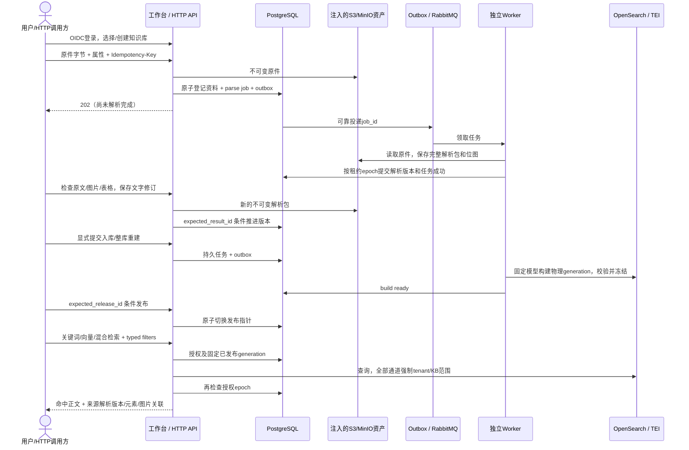

# 生产平台 HTTP 与工作台

`inkrag_platform.api.create_app(runtime)` 只装配已就绪的依赖。它不迁移数据库、不启动 Docker、不加载模型，也不在请求进程解析文件。初始化、依赖检查和连接关闭由 `wiring` / CLI 管理。

网页和 HTTP 客户端使用同一 `/api/v2` 控制面。旧的同步 `/api/v1` 开发宿主由 Git 历史保留，平台只提供 `/api/v2` 正式协议。

新增全局聚合、审核/选用、结构修订、服务冻结、逐题标注与发布审阅的精确契约见[工作空间协议](workspace-http-contract.md)。前端修复版的实际部署与验收范围以[当前验证](release-readiness.md)为准。

## 一条完整用户流程

关闭页面不会丢失已接受任务。工作台定时读取 PG 事实，展示真实阶段与失败，不生成虚构百分比。取消和重试由服务器状态机判断。修改解析或业务字段不自动改变在线发布；删除通过本次冻结清单内的可信撤销交集前置过滤，查询前后复核授权版本，其余资料继续可查。发布/回滚不能复活已撤销资料。

## 协议与授权

- 身份由 OIDC 的签名、issuer、audience、有效期及可信 `tenant_id` / 角色声明产生；请求不能覆盖租户。管理角色是 `admin` / `editor` / `viewer`。
- 浏览器采用 `oidc-client-ts` 的 Authorization Code + PKCE S256。访问/刷新令牌只保存在内存；会话存储仅保存跨跳转的临时协议状态、KB 选择和未确认上传的随机幂等键，不保存文档草稿或令牌。
- 自动续期更新内存 token，客户端引用保持稳定，不重新挂载审校表单。续期失败保留当前草稿，使用登录弹窗恢复会话；退出登录同时结束身份服务会话。
- 调用方密钥由管理员签发，仅限单个 KB 的只读权限，服务器只存摘要；明文仅签发时返回一次，撤销后逐请求检查。
- 原件和图片摘要不是凭证。每次下载同时检查当前主体对资料的可见范围，再使用租户隔离的注入资产仓库读取；撤销资料后不能继续按旧摘要下载。
- 没有 wildcard CORS。页面同源部署，使用 CSP、`nosniff`、`no-referrer`；API 禁止缓存。文档内容按普通文本展示，图片仅内联经过签名判断的位图，主动 HTML/SVG 不执行。

## 三种版本

| 身份 | 含义 | 并发条件 |
| --- | --- | --- |
| `Document.revision` | 资料聚合版本；属性或解析内容变化都递增 | 删除/属性修改使用该 revision |
| `ParseResult.result_id` + `ParseResult.revision` | 不可变解析包的摘要与解析修订链 | 文字审校使用 `expected_result_id` |
| `Release.release_id` + `Release.version` | 已发布物理索引的权威引用 | 发布/回滚使用 `expected_release_id` |

`indexed_revision` / `indexed_result_id` 表示当前发布投影。`build.ready` 只表示候选构建完成。冲突返回 409；工作台保留文字草稿，用户核对最新版本后再操作。

解析详情响应是 `{document, result}`。任务未完成时 `result=null`，不会返回假解析结果。`result` 保留 InkParse / Docling 原生 JSON，包括来源、文本、表格、图片绑定、定位及警告。完整内容与资产字节在对象存储，PG 保存业务归属、版本、任务、发布及资产授权引用。

## 主要接口

| 操作 | 路径 | 结果 |
| --- | --- | --- |
| 存活 / 依赖就绪 | `GET /health/live` / `/health/ready` | 200 或就绪 503；就绪不代表容量已验收 |
| 公开 OIDC 配置 | `GET /api/v2/session/config` | 无秘密的 issuer / client_id / mode |
| 当前身份、能力、状态 | `GET /api/v2/me` / `capabilities` / `status` | 授权范围、实际格式、依赖探测、固定模型身份 |
| 知识库 | `GET/POST /api/v2/knowledge-bases` | 当前主体可见列表 / 创建 |
| 编辑字段定义 | `GET/PUT /api/v2/knowledge-bases/{kb}/fields` | KB revision CAS；仅管理员可写 |
| 在线筛选字段 | `GET /api/v2/knowledge-bases/{kb}/search-fields` | 实际已发布 generation 的冻结 schema |
| 资料目录 / 导入 | `GET/POST /api/v2/knowledge-bases/{kb}/documents` | 分页目录 / 202 parse job |
| 当前/历史详情 | `GET /api/v2/documents/{id}?result_id=...` | 已授权的明确解析版本 |
| 保存文字 / 属性 | `PATCH /api/v2/documents/{id}` / `{id}/metadata` | CAS 保存；不自动发布 |
| 版本历史 | `GET /api/v2/documents/{id}/versions` | 不可变解析版本元信息 |
| 显式入库 | `POST /api/v2/documents/{id}/ingest` | 202，冻结 result 和资料聚合 revision |
| 整库重建 | `POST /api/v2/knowledge-bases/{kb}/builds` | 202；支持字段变化和删除后空库恢复 |
| 任务 | `GET /api/v2/jobs?kb_id=...` / `{job}` | 持久状态、阶段、attempt、错误类别 |
| 取消 / 重试 | `POST /api/v2/jobs/{id}/cancel` / `retry` | 取消屏障 / 仅合法失败任务重试 |
| 构建 / 发布历史 | `GET /api/v2/knowledge-bases/{kb}/builds` / `releases` | 候选与已发布事实分开 |
| 发布 / 回滚 | `POST /api/v2/builds/{id}/publish` / `/releases/{id}/rollback` | 条件切换；撤销的旧授权不能被回滚复活 |
| 检索 | `POST /api/v2/retrieve` | 固定发布上的 keyword / vector / hybrid；拒绝用户传 index/generation |
| 调用凭证 | `GET/POST /api/v2/knowledge-bases/{kb}/callers` | 管理员元信息 / 一次性明文 |
| 撤销凭证 / 资料 | `DELETE /api/v2/callers/{id}` / `/documents/{id}?expected_revision=...` | 立即生效的授权撤销 |
| 样本 / 评测 | `GET/POST /api/v2/knowledge-bases/{kb}/samples` / `evaluations` | 人工标注 / 202真实后台评测 |
| 审计 | `GET /api/v2/audit?kb_id=...` | 管理员有界操作记录，不含正文/秘密 |
| 下载 / 导出 | `GET /api/v2/assets/{sha}` / `/documents/{id}/export?format=json\|markdown` | 受权原件、图片及明确版本导出 |
| 协议说明 | `GET /api/v2/openapi.json` | 受保护的原生 OpenAPI |

上传使用原始字节 body、`?filename=...` 和 `Idempotency-Key`。业务属性放在 `X-Ink-Metadata`，内容是 UTF-8 JSON 的百分号编码（例如 `encodeURIComponent(JSON.stringify(metadata))`）；服务器按 KB 字段声明验证。浏览器在上传前填写必填属性。未确认上传保留同一文件/属性的幂等键，网络结果未知时再次选择相同文件可核对原意图，避免盲目创建新任务。

筛选是 AND 条件数组，例如 `[{"field":"department","operator":"eq","value":"财务"}]`。支持受控比较和集合条件，不接受 OpenSearch 原始 DSL。工作态字段与在线字段分开读取，避免尚未发布的字段造成假命中。

## 预算和故障语义

上传实际流限制 20MiB，总正文读取 60 秒、单次等待 30 秒；控制 JSON 为 4MiB。全局 HTTP 并发由启动入口约束。API 每进程另有两个上传槽和两个完整解析包/资产/导出/文字修订槽，读取正文前立即检查；忙时返回 429 + `Retry-After: 2`，不堆积等待队列。大响应按64KiB分块触发服务器原生drain，槽位持有至ASGI全部发送结束，避免单次20MiB写入绕过慢客户端背压；普通管理和检索不抢大文件槽。

接受任务必须同时持久化资料/job/outbox。S3 成功而 PG 失败可能留下无引用的不可变对象，但不能返回已接受成功，也不能删除其他任务的去重对象。任何原件、解析包或索引失败都不会降级为本地存储、空知识或假成功。

评测冻结发布与人工样本，实际调用检索、按 `document_id` 去重后复用LlamaIndex原生Recall / Precision / MRR计算宏平均指标。指标是文档级检索回归，不是解析准确率或问答正确率；没有真实标注时拒绝运行。worker 以租约 epoch 同事务保存指标及成功状态，取消/失权执行者不能迟到提交。

## 当前边界与验证

工作台支持 TXT / Markdown / 文本 PDF / HTML / JSON / XML / CSV / DOCX / PPTX，具体范围直接来自解析核心 `FORMATS`。不把旧 DOC/PPT、扫描 OCR、任意远程网页抓取或图意识别宣传成已实现。业务字段支持文字、数值、日期、布尔与枚举。原生表格只读预览保留合并单元格；正文每组50个元素、表格每组5份，大表预览最多前100行/列，导出JSON保留完整数据。文字支持审校，图片资产不可变；不提供像素编辑或复杂表格结构编辑。

`tests/test_platform_http.py` 对专用真实 PG 验证 HTTP/CAS/归属，以及 ASGI 槽位反例；测试资产用临时适配器，不据此声称 S3 已验收。`tests/test_platform_stack.py` 默认跳过，显式 `INKRAG_STACK_INTEGRATION=1` 时读取 `INKRAG_STACK_STATE_DIR` 指定的测试栈账号文件，默认目录为 `.inkrag`，贯穿真实 OAuth、Rabbit、S3、隔离解析、TEI、OpenSearch、发布、凭证、评测和删除恢复，不使用业务 mock。浏览器验收截图保存于 `web/evidence/platform-workbench.png`。

## 可选解析工具（2026-11-11）

二进制上传`POST /api/v2/knowledge-bases/{kb_id}/documents?filename=manual.docx&parser_engine=docling`，省略parser_engine时沿用builtin。Idempotency-Key仍必填，换工具属于不同意图，不能复用同一键。服务能力的parse_engines提供各工具格式、可用状态及pending_formats；未预置模型时PDF/图片不在Docling可直接选择范围。JSON交换中的options.engine记录非默认工具，engine记录实际引擎及版本。任务重试、原件重解析和替换原件沿用持久选择；不支持的替换格式明确拒绝，不隐式换工具。

## 资料导入向导

以下路径位于 `/api/v2/knowledge-bases/{kb_id}/imports` 下。调用者需要库的编辑权限，暂存和预览仅供上传者使用。

1. `POST /staged?filename=manual.docx` 上传二进制原件，返回 `stage_id`。单份上限 20 MiB，暂存有效期 24 小时。
2. `POST /previews` 提交 `stage_id` 和 `rules`，需附 `Idempotency-Key`。`rules` 包含 `engine`，可选 `exclude_headers` 和 `exclude_images`。前者排除解析工具已识别的页眉页脚，后者排除清洗结果中的图片，两项均保留原件。
3. `GET /previews/{job_id}` 读取状态和清洗前后正文样例。后台预览与正式任务共用隔离执行器，完整结果按摘要存储。预览正文各最多 16,000 字符，并返回至多 30 个解析文本块样例。
4. `POST /confirm` 提交 `items`，每项包含 `preview_id` 和 `metadata`，每批最多 20 份。整批校验并事务登记资料与解析任务，重复确认同一请求返回已有任务。正式解析任务采用预览冻结的完整结果，随后可按原流程审校及选用。

过期暂存限制后续预览及首次确认。未确认的资产沿用存储层的内容寻址和保留机制，过期时不会自动删除对象。

参数扩展：`rules`还接受`ocr_enabled`、`ocr_mode`（auto/full_page）、`table_structure`、`table_mode`（fast/accurate）、`processing`（chunking/chunk_size/chunk_overlap/include_title）。OCR范围与表格参数仅Docling PDF/图片可用，父开关关闭后不接受子参数。处理默认值和模型上限来自`/api/v2/capabilities`的`processing`，仅RAG装配提供。

预览另返回实际`chunk_count`、前20个`chunks`（text/token_count/element_ref/page）、`effective_processing`、`max_tokens`和`chunks_truncated`；与正式索引共用切分器和分词器，预览不执行嵌入。确认将处理配置持久化到资料，再冻结进构建清单，随后按本库自动生效设置处理。

## 默认知识更新

`POST /api/v2/knowledge-bases/{kb_id}/builds?incremental=true` 接受持久构建任务，固定当时的知识库修订号和线上发布 ID。Worker 叠加已选用的结果和属性，沿用线上未撤销的资料及服务策略。取消选用的旧线上资料留在默认更新的基线内。省略该参数的专业构建按选用清单和服务草稿工作。

审阅和发布都绑定准备时的线上发布 ID。资料或线上指针变动时需重新准备；同一次已生效的候选可按原基线重试确认。`PUT /api/v2/documents/{id}/selection` 可选 `confirm_content=true`，在同一事务里记录当前版本的人工确认并选用。无警告的导入预览确认后由正式解析任务准备选用，不写人工审核记录。

当前资料入口使用自动生效。`PUT /api/v2/knowledge-bases/{id}/auto-activation` 用 `enabled` 控制后续上传。关闭会撤回尚未生效的自动请求。`PATCH /api/v2/documents/{id}/structure` 可携带 `activate: true` 和 `expected_document_revision`，将新版本和生效任务原子提交；已有当前版本可用选择接口的 `activate: true` 手动生效。生效任务从线上快照叠加明确授权的资料，索引就绪后同事务切换线上指针。
