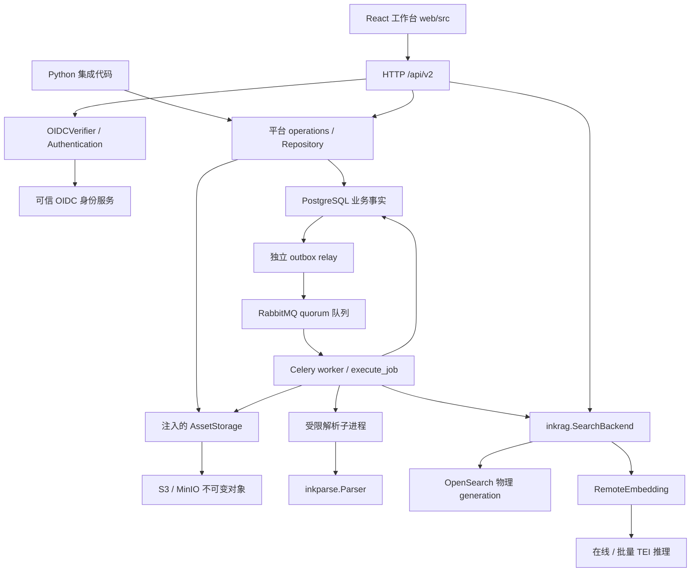
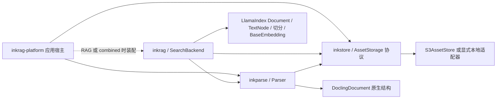
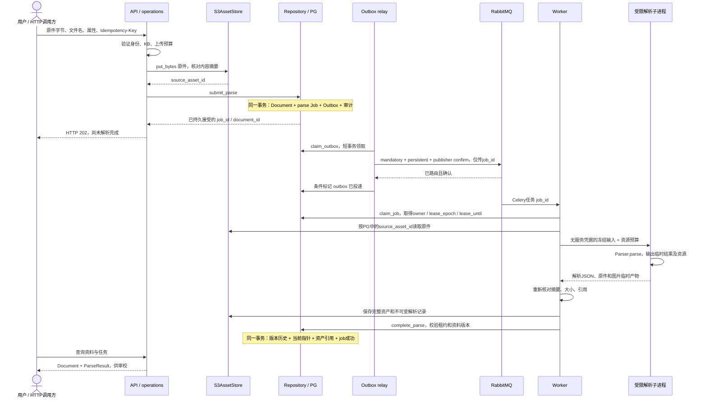
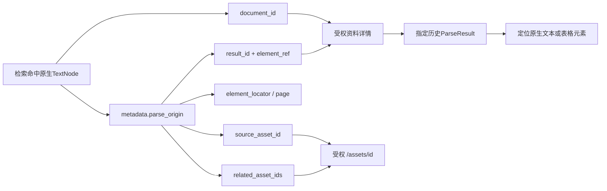
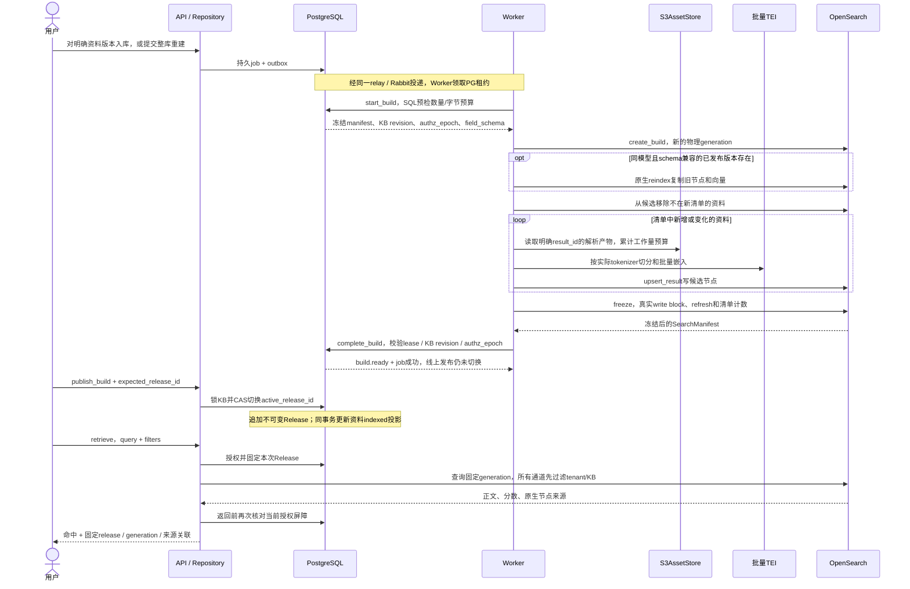

# 当前平台实现：从上传资料到可检索知识

先看一个场景。上传一份带图片的 DOCX，检查解析正文并修改一个错字，再让它进入知识库。系统会依次产生原件资产、解析版本、索引候选和正式发布。上传接受、解析成功、候选冻结和正式发布是四个状态。导入可按知识库配置自动发起构建及发布，也可在审校后手动操作。现有发布在新候选通过发布条件前继续服务。

启动、连接和运维见[运行手册](production-runbook.md)，请求细节见[HTTP v2](platform-http.md)及[工作空间协议](workspace-http-contract.md)。本轮功能、结构审查和已验证范围见[发行验收](release-readiness.md)。

## 1. 整体结构：谁负责哪一份事实



三类持久内容分开保存：

| 内容 | 权威位置 | 原因 |
| --- | --- | --- |
| 租户、KB、资料归属、当前解析指针、任务、租约、发布指针、凭证摘要、审计 | PostgreSQL | 这些状态需要跨进程事务、条件提交和一致的授权判断 |
| 原始文件、提取出的图片、不可变解析 JSON 记录 | S3 / MinIO | 以稳定摘要寻址，资料修订不覆盖原件或旧解析包 |
| 切分后的节点、向量、关键词索引、冻结字段 schema | OpenSearch | 执行检索；它不决定哪个版本已经正式发布 |

RabbitMQ负责通知执行者，不保存另一份业务状态。页面查询任务时读 PG；检索选择哪个物理索引也读 PG 的发布记录。应用进程内没有第二份“当前发布”缓存或搜索 alias 指针。

## 2. 模块怎样划分



| 模块 | 当前实际职责 | 不由它决定的事情 |
| --- | --- | --- |
| `inkparse.Parser` | 读取冻结输入；生成 `ParseResult`；保留原生文本、表格、图片绑定、来源定位和警告 | 租户授权、知识库、任务调度、模型或发布 |
| `inkstore.AssetStorage` | 约定资产与不透明记录的保存、读取和完整性校验 | 不理解 Docling、解析版本或 RAG 节点 |
| `inkrag.SearchBackend` | 从解析结果生成原生节点；构建候选；冻结；在固定 generation 内检索 | 不修改 PG 发布指针，也不选择备用本地后端 |
| `inkrag_platform.Repository` | 统一租户/KB检查、资料和版本条件、job/outbox事务、执行租约、构建及发布规则 | 不读取 PDF、不调用模型、不把外部网络请求放在数据库事务内 |
| `operations.py` | 串联授权读取、上传、文本修订、导出和评测等短业务流程 | 不创建连接、不在 HTTP 请求中跑长解析或整库构建 |
| `broker.py` / `worker.py` | 可靠投递、失联恢复、执行领取、心跳、解析/构建/评测执行 | 消息不能自行指定 tenant、KB 或任意存储地址 |
| `wiring.open_runtime()` | 唯一基础设施装配点，创建并关闭连接，把依赖注入 `Runtime` | 构造业务对象时不偷偷起 Docker、迁移或下载备用模型 |
| `api.py` / `web/src` | HTTP投影和用户交互；展示持久任务、版本、候选和发布 | 不在前端维护一份服务端任务状态，不用进度动画冒充实际完成 |

生产事实映射在 `database.py`，正式建表通过 `migrations/` 中的 Alembic 版本执行。API、worker、relay只检查已存在的 schema。运行角色必须是受限的非表 owner；当前租户隔离由可信 `Principal`、仓库查询、复合外键和资产命名空间共同实施，未实现数据库 RLS 策略。

## 3. 上传和解析：原件什么时候保存



因此，原件在返回202之前已经保存到对象存储。图片在解析阶段被提取，子进程先写本次临时目录，父进程校验后保存到同一租户的对象存储。完整解析记录保存成功后，才调用 `complete_parse()` 提交PG业务状态。

这个顺序没有假设 S3 与 PG 之间存在分布式事务。若S3保存成功而PG失败，可能留下尚未引用的对象；系统不会返回“已接受”，也不会盲删可能被其他资料复用的对象。若PG提交已成功但应答丢失，同一幂等键和相同请求可以取回既有任务；同一键换了文件或参数会产生 `idempotency_conflict`。

### 子进程究竟隔离了什么

`sandbox.run_parse()`启动固定的 `inkrag_platform.executor` 入口。子进程没有PG、Rabbit、S3或OIDC凭据，使用临时 `ScratchStorage` 传输产物，它不是本地持久化回退。

Linux执行面使用资源限制、Landlock文件访问规则和seccomp：只允许本次工作目录写入、必要运行库只读；拒绝网络、派生进程/线程、跟踪及发送信号等操作。必要内核能力不可用时拒绝解析。父进程还限制墙钟时间，并重新检查返回文件和摘要。macOS显式开发模式保留部分资源/时间限制，不等同Linux文件与系统调用隔离。

当前格式来自 `inkparse.parser.FORMATS`：TXT、Markdown、文本PDF、HTML、JSON、XML、CSV、DOCX、PPTX。解析分别使用UTF-8、pypdf、BeautifulSoup、标准库和成熟Office库，再写入Docling原生结构。这里使用的是 `docling-core` 结构模型，并未把Docling完整视觉流水线或LlamaParse云解析接进来。

## 4. 解析结果里有什么，图片和URL怎么关联

`ParseResult` 使用 `inkparse.result.v3` 协议，主要字段如下：

| 字段 | 保存的真实内容 |
| --- | --- |
| `source` | 原件名称、格式、SHA256、大小、`asset_id`；不暴露解析机器绝对路径 |
| `document` | `DoclingDocument` 原生文本、表格、图片和可获得的页/坐标信息 |
| `assets` | `asset_id`、`element_ref`、资源角色、可选页码、媒体类型 |
| `origins` | 原生元素对应的逻辑 `locator`，以及可选的外部资源 `resource_uri` |
| `engine` / `options` | 实际读取器和版本、执行配置 |
| `coverage` / `warnings` | 文本/原生结构覆盖范围，以及外链未抓取、视觉信息缺口等事实 |
| `result_id` / `revision` / `previous_result_id` | 内容摘要和不可变解析修订链 |

资产不是直接塞进JSON的base64字符串。`assets`保存稳定引用；字节由注入的资产服务负责。生产装配按租户摘要分命名空间，实际对象组织为：

```text
<配置前缀>/<SHA256(tenant_id)>/
  objects/<asset_id>     原件或提取图片的字节
  records/<result_id>    StoredRecord，包含解析JSON和资产引用
```

`asset_id`是原件/图片字节的SHA256；`result_id`是整个解析内容的摘要。两者用途不同：`GET /api/v2/assets/{asset_id}`下载字节；解析JSON应通过指定资料版本的详情或导出接口获取，不能把 `result_id` 当成图片下载地址。

`S3AssetStore`以条件新增写入对象，同内容复用，已有对象冲突或损坏明确失败。`inkstore`只认识 `StoredRecord` 和资源引用；由 `inkparse.persistence.save_stored_result()` / `load_stored_result()`解释这些记录与解析模型的关系。

### 一个命中怎样回到原文



`SearchBackend.result_nodes()`在每个节点保留 `document_id`、解析 `result_id`、`element_ref`、逻辑定位、原件资产及相关图片ID。工作台“查看来源版本”使用资料ID和命中的解析版本打开审校视图，并定位对应元素；资料后来修订，也不会把旧命中错误地指向新正文。

原件下载仍由PG确认可见性：`Repository.has_asset()`要求资产至少被当前主体可见、未删除的资料引用，然后才读取该租户的存储前缀。历史版本引用仍可以为该资料的授权用户提供资源。摘要本身不是访问凭证，也不向浏览器暴露匿名S3地址。

定位能力按原件实际信息区分：PDF目前的文字位置是整页范围，不是精确文字框；DOCX主要是OOXML正文逻辑路径，不推测Word渲染页码；HTML使用DOM路径；PPTX可以保留幻灯片及原生形状信息。表格保存原生单元格及合并跨度。具体逻辑定位保存在 `origins`，不把它伪装成渲染坐标。

图片当前作为资源保留，未接入通用OCR、图意理解或图片向量。检索节点包含正文和表格文字，跳过图片本身；命中的相关图片是元素绑定、同页或无页码时的来源附件，未经过语义匹配。源HTML的 `alt` 是来源标注，也不是模型生成的图意描述。

URL也要分清来源：当前解析输入是文件，HTTP接受上传字节；没有任意远程网页抓取入口。HTML的base64位图可以成为资产，外部 `src` 或本地相对地址只保存在 `resource_uri` 并产生未抓取警告，不自动访问网络或宿主文件。网页脚本不执行，原始HTML保存在原件中；JSON、CSV等内容里的URL也不会触发自动抓取。

## 5. 从资料到在线知识：候选、冻结、发布



当前一次入库任务构建的是KB全部已解析、未删除资料的清单，而不只是上传的单个文件。单资料入库会先冻结触发资料的解析版本与聚合版本；整库重建也支持没有资料的空候选，用于删除后的发布恢复。新建或变化的资料重新嵌入；完全未变化的资料复用旧向量。模型不一致、已有字段被删除或改变索引类型时，创建新候选，不把旧索引硬接到新契约。

`RemoteEmbedding`是LlamaIndex `BaseEmbedding`的HTTP适配，连接独立TEI进程。在线查询和批量任务可使用不同资源池。它校验实际模型、权重revision、池化、维度和输入预算，使用随包固定的tokenizer；超长输入明确失败，不用截断隐藏正文损失。切分和节点仍使用LlamaIndex原生结构，混合排序使用OpenSearch RRF搜索流水线。

`freeze()`会实际封锁后端写入，等待刷新并核对分片及节点/资料计数。PG的 `build.ready`只在这些操作成功、执行权仍有效且KB未变化时提交。`publish_build()`随后在PG中判断当前发布是否仍等于调用方看到的 `expected_release_id`，才追加发布并切换指针。

查询从不接受调用方自报的物理索引名。一次请求固定一个已发布generation，随后即使其他用户正常切换发布，也不会把本次请求的两个检索通道混在不同版本里。关键词、向量和混合通道都包含可信租户/KB过滤，后端结果还要核对范围；超时、失败分片或模型契约不一致明确失败。

## 6. 三条版本轴，以及另外两道执行屏障

| 标识 | 什么时候变化 | 解决的问题 |
| --- | --- | --- |
| `Document.revision` | 解析指针、业务属性或删除状态变化 | 整份资料的聚合CAS；属性修改、删除和入库提交不能悄悄越过别人修改 |
| `ParseResult.result_id` / `revision` / `previous_result_id` | 创建新解析结果或文字修订 | 不可变解析历史；文本审校使用 `expected_result_id` |
| `Release.release_id` / `version` | 正式发布或回滚追加记录 | 在线知识版本；使用 `expected_release_id` 防止覆盖另一次发布 |

例如初次解析后，资料聚合版本为1，解析版本也是1。只修改部门属性后，资料变成2，解析结果仍是原来的1。随后审校正文，解析版本成为2，资料聚合版本成为3。两者不是同一条计数器。

另外还有KB聚合 `revision`：资料创建、解析/属性变化、删除和字段声明变化会推进它。构建冻结这个值；ready提交和正常发布都核对它，因此候选生成后发生的修改不会被旧候选覆盖。`indexed_revision` / `indexed_result_id`只是当前发布清单对资料的投影，构建ready时不更新，发布/回滚事务中才更新。

两道屏障分别解决不同问题：

| 屏障 | 当前实现 | 拦住什么 |
| --- | --- | --- |
| 执行租约 `lease_epoch` | PG时钟、owner和截止时间；每次领取/失效推进epoch，`LeaseGuard`独立心跳 | 被取消、失联或被接管的旧worker迟到提交结果 |
| KB授权 `authz_epoch` | 当前删除资料会推进；Build和Release冻结该值；查询前后核对 | 删除后旧发布继续返回旧知识，或通过回滚复活已撤销内容 |

执行次数 `attempt` 与 `lease_epoch`也不同。自动执行最多三次，显式重试可以重置次数，旧epoch不会因此复活。仓库在锁后重新加载ORM对象，避免已经缓存的旧状态覆盖刚发生的取消或修改。

当前角色由可信OIDC声明产生，调用密钥限定单KB只读；没有另外实现细粒度文档ACL管理器。租户停用和凭证撤销也要检查，但不能把它们误解为每次都会推进KB授权epoch。

### 业务属性与字段声明怎么冻结

`MetadataField`支持文字、数值、ISO日期、布尔和枚举。资料属性只接受已声明标量，不把未知字段、错误类型或嵌套对象转成文字。`set_fields()`要求管理员权限和KB revision CAS，并校验当前资料是否都满足新声明；不满足则整次拒绝。增加必填字段时，可先设为可选、补齐资料，再改为必填。

`start_build()`把工作态声明转换为候选的 `field_schema`：枚举按文字索引，日期保留日期类型。旧发布的物理schema保持冻结，在线筛选字段读取实际已发布generation；工作态字段编辑不会立即改变线上过滤语义。回滚追加一条发布记录，仍必须通过当前授权屏障，不会重写旧物理索引或自动切换模型服务。

## 7. 故障发生后，系统如何收敛

| 故障位置 | 当前行为与恢复入口 |
| --- | --- |
| 上传响应丢失 | 保留同一请求的幂等键核对既有job；请求不同则冲突，不盲建第二份资料 |
| S3写成功、PG未接受 | 不返回202；对象可能暂时无引用，等待受控对账，当前没有自动GC |
| PG已接受、relay未投递 | doc/job/outbox在同一事务；relay继续领取，不依赖页面保持打开 |
| Rabbit未路由、nack或确认丢失 | mandatory和publisher confirm失败不能记为已送达；outbox保留或过期重领，同job允许重复投递 |
| 重复任务到达 | `claim_job()`只允许合法状态领取；已成功或取消任务不再推进版本 |
| worker被杀或失联 | 租约到期后 `recover_jobs()`使旧epoch失效并补投递；已有pending/sending意图时不无限追加重复outbox |
| 取消后旧worker仍在外部调用 | 取消立即使PG执行权失效；外部调用可能尚未结束，但后续检查/提交会失败；候选不能发布 |
| 解析、字段、清单等确定性错误 | 保存安全错误类别，任务失败；不按暂时故障反复重试 |
| 暂时依赖故障 | worker分类后有限重试；连接和提交不确定时重新核对PG，不把已成功任务改回失败 |
| 候选写入/冻结/计数失败 | 不切换在线发布；失权或失败任务的building候选标为failed，保留身份供后续审计 |
| 构建中资料或声明变化 | `complete_build()`拒绝过期候选；ready后再变化则正常发布CAS拒绝，需新建构建意图 |
| 删除资料 | PG立即撤销目录/资产可见性并推进授权屏障；旧发布排除已撤销资料，其余资料仍可检索 |

发布回滚不等于恢复被删除的文件；逻辑删除也不等于物理擦除S3对象。当前保留不可变历史，不自动执行对象GC、保留期清理或灾备恢复。

评测走同一持久任务与执行权机制。`evaluate_release()`读取固定发布和真实人工样本，按资料ID去重，计算文档级Recall、Precision、MRR；`record_job_evaluation()`把租约检查、评测记录和job成功放在同一PG事务。它衡量检索回归，不代表解析准确率或问答正确率。

## 8. 容量是明确预算，不是无限扩展承诺

| 保护线 | 当前默认值 / 行为 |
| --- | --- |
| 单原件/单资产 | 最大20MiB；流式接收有总时限和单次等待预算 |
| 单解析JSON | 最大32MiB；子进程产物和父进程采用时都检查 |
| 解析临时资源 | 总计64MiB、最多256份；单资源20MiB |
| 单任务解析资源 | 默认512MiB地址空间、60秒CPU预算，另有父进程墙钟限制；Linux执行 |
| 结构化格式适配 | `StructureBuilder`限制20000个元素、100000个表格单元格，具体格式另有层级/ZIP限制；PDF执行仍受独立资源/时间预算约束 |
| 单资料业务属性 | 最多64个字段、16KiB，且类型符合KB声明 |
| 单次KB构建清单 | 默认最多5000份已解析资料、16MiB；配置安全上限为20000份、64MiB |
| 本次实际读取的解析JSON | 默认累计256MiB，配置安全上限1GiB；未变化资料原生reindex，不计入本次S3记录读取量 |
| 单个job总时限 | 默认3600秒，执行并发默认1；不是靠无限加worker争抢模型 |
| PG访问 | 有界连接池、连接/语句/锁/空闲事务超时；短事务不跨S3、模型或搜索请求 |
| API大内容 | 上传和大响应有独立并发槽，忙时明确429，不无限堆积完整文档对象 |

`start_build()`在KB锁后先做有界SQL计数和字节聚合，最多取数量预算加一份用于判断超额；通过后才在应用内创建完整清单。`get_build()`也先检查存量清单预算。构建列表仅返回摘要，`manifest_included=false`，完整清单按需读取，避免一次展开一百个候选。

worker通过 `BuildInputStorage`累计本次实际读取的解析记录，超额在解码完整 `ParseResult`之前停止。这个值控制任务处理量，不是进程内存、图片传输量或网络总字节上限。数量、清单或累计输入超额统一产生 `build_budget_exceeded`，不创建假成功，也不自动重试；调用方应拆分KB或按目标环境重新评估预算。

当前清单仍以有界JSONB快照保存。上述保护线让超额请求可预测地失败，并不证明超大KB、混合负载、HA或灾备能力。调整连接和预算的配置入口集中在运行手册，本文不复制连接串或部署秘密。

## 9. 从哪里开始读代码

下面按调用顺序定位。路径相对仓库根目录，点击链接可进入对应源码。

| 要理解的事情 | 文件与实际入口 |
| --- | --- |
| 启动和依赖生命周期 | [CLI](../packages/inkrag-platform/src/inkrag_platform/cli.py) `main()`；[wiring](../packages/inkrag-platform/src/inkrag_platform/wiring.py) `open_runtime()` |
| HTTP投影、流量预算、下载授权 | [api.py](../packages/inkrag-platform/src/inkrag_platform/api.py) 装配路由，[http_limits.py](../packages/inkrag-platform/src/inkrag_platform/http_limits.py) 实施正文预算和背压 |
| 当前用户与调用密钥 | [auth.py](../packages/inkrag-platform/src/inkrag_platform/auth.py) `OIDCVerifier.verify()`；`wiring.Authentication.verify()` |
| 组合业务短流程 | [operations.py](../packages/inkrag-platform/src/inkrag_platform/operations.py) `submit_upload()`、`document_view()`、`save_revision()`、`export_document()` |
| PG事实、版本与发布 | [repository.py](../packages/inkrag-platform/src/inkrag_platform/repository.py) `submit_parse()`、`accept_job()`、`complete_parse()`、`start_build()`、`complete_build()`、`publish_build()`、`rollback_release()` |
| 表映射和正式迁移 | [database.py](../packages/inkrag-platform/src/inkrag_platform/database.py) `Database`；[migrations](../packages/inkrag-platform/src/inkrag_platform/migrations/) |
| 投递与恢复 | [broker.py](../packages/inkrag-platform/src/inkrag_platform/broker.py) `BrokerPublisher.publish()`、`relay_once()`、`run_relay()`；`Repository.recover_jobs()` |
| 后台任务实际执行 | [worker.py](../packages/inkrag-platform/src/inkrag_platform/worker.py) `execute_job()`、`LeaseGuard`、`_parse()`、`_build()`、`_evaluate()` |
| 受限解析与产物采用 | [sandbox.py](../packages/inkrag-platform/src/inkrag_platform/sandbox.py) `run_parse()`；[executor.py](../packages/inkrag-platform/src/inkrag_platform/executor.py) `restrict()`、`ScratchStorage` |
| 独立解析与统一JSON | [parser.py](../packages/inkparse/src/inkparse/parser.py) `Parser.parse()`；[models.py](../packages/inkparse/src/inkparse/models.py) `ParseResult`、`AssetBinding`、`ElementOrigin` |
| 图片、表格与来源定位 | [structure.py](../packages/inkparse/src/inkparse/structure.py) `StructureBuilder`；`html.py`、`structured.py`、`office.py`各格式适配 |
| 资产协议和S3实现 | [contracts.py](../packages/inkstore/src/inkstore/contracts.py) `AssetStorage`、`StoredRecord`；[s3.py](../packages/inkstore/src/inkstore/s3.py) `S3AssetStore` |
| 解析记录与资产的映射 | [persistence.py](../packages/inkparse/src/inkparse/persistence.py) `save_stored_result()`、`load_stored_result()` |
| 节点、构建、冻结和查询 | [search.py](../src/inkrag/search.py) `result_nodes()`、`SearchBackend`；[documents.py](../src/inkrag/documents.py)共享切分 |
| 固定模型和token预算 | [embedding.py](../packages/inkrag-platform/src/inkrag_platform/embedding.py) `RemoteEmbedding`、`load_tokenizer()` |
| 页面状态和来源跳转 | [web/src/api.ts](../web/src/api.ts)、[workbench.tsx](../web/src/workbench.tsx)、[review.tsx](../web/src/review.tsx)、[search.tsx](../web/src/search.tsx) |

## 10. 独立解析产品与轻量本地SDK的区别

“独立”有两层含义，不能混为一种部署方式：

| 入口 | 实际依赖和用途 |
| --- | --- |
| `inkparse.Parser.parse(request, assets=...)` | 同步解析库；不需要PG、Rabbit、OIDC、LlamaIndex或embedding。调用方决定是否注入资产服务；没有资产服务时不能宣称图片已保存 |
| 平台 `capabilities=parse` | 独立的解析HTTP/工作台产品，保留PG、S3、身份、持久任务和隔离worker，不装配OpenSearch或TEI。它不是把企业状态改回本地文件 |
| 平台 `capabilities=rag` / `combined` | 装配 `SearchBackend`、固定模型和发布/检索。当前RAG模式仍可通过HTTP导入资料并调用同一解析核心；不是另一套解析实现 |
| `inkrag.RAG.open(path, embedding=..., assets=...)` | 显式轻量本地SDK，SQLite元数据、文件锁和本地索引用于单机开发/嵌入式使用，不承担平台多节点事务、OIDC、持久队列和发布控制 |

生产平台没有调用 `RAG.open()`再把本地数据库换一个连接串。它使用 `Repository` 管理平台事实，使用 `SearchBackend` 连接外部检索；两条路径复用解析契约、原生文档/节点和切分能力，但不是同一份存储状态，也不会自动迁移本地SDK目录。

若通过Python控制生产平台，当前可复用 `Runtime`、`operations`、`Repository`和任务入口，或调用正式HTTP协议。不能拿本地SDK的锁和快照格式推导生产平台的并发保障。解析可以独立产出JSON，RAG可以消费明确的解析版本，资产服务通过协议注入；组合时由平台负责把它们的身份、授权和提交顺序串起来。
